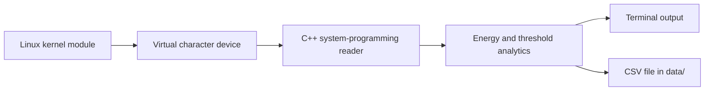
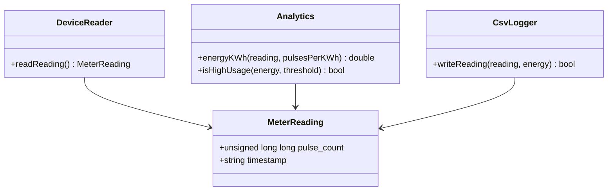
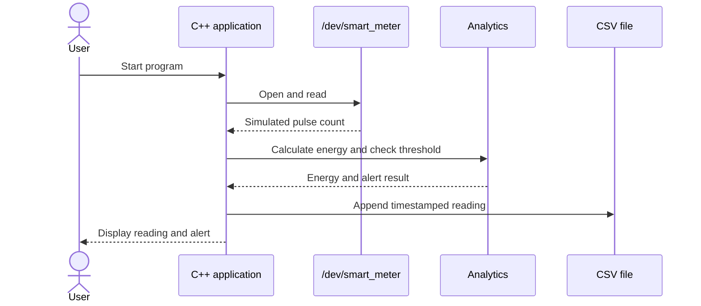
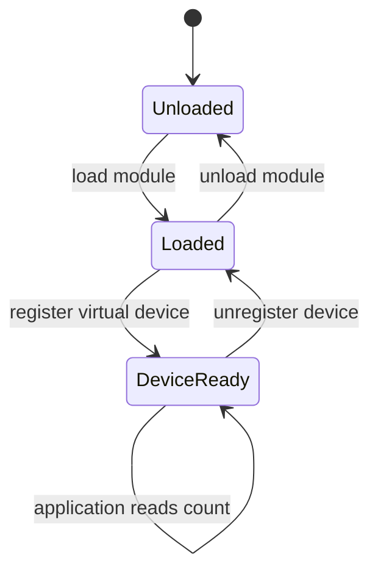

# Stage 3 — System Design and Architecture

## Design goal
The Linux kernel module simulates a meter and exposes readings through a virtual character device. The C++ program reads the device, calculates energy, checks a threshold, and saves each reading as a CSV row.

## Architecture



## Component responsibilities
- **Kernel module:** Maintains a simulated cumulative pulse count.
- **Virtual character device:** Lets the application open and read a meter value.
- **C++ reader:** Retrieves the value using Linux system calls.
- **Analytics:** Converts pulses to kWh and checks a usage threshold.
- **CSV storage:** Saves timestamp, pulse count, and energy.
- **Terminal interface:** Displays readings and alerts.

## Data structure
The C++ program will represent a reading like this:

```cpp
struct MeterReading {
    unsigned long long pulse_count;
    std::string timestamp;
};
```

Energy calculation:

```text
energy_kWh = pulse_count / pulses_per_kWh
```

`pulses_per_kWh` must be greater than zero.

## UML class diagram



## UML sequence diagram



## UML state machine diagram



## Environment and Git workflow
- Environment: Ubuntu VM, C/C++ compiler, Git, and matching kernel build files.
- `main` holds completed milestones.
- Larger changes can use a feature branch and merge into `main` after they build and work.
- Store documents in `docs/`, source in `driver/` and `app/`, and generated readings in `data/`.

## Implementation plan
1. Build and load a minimal kernel module.
2. Expose simulated readings through `/dev/smart_meter`.
3. Write a C++ program that reads from the device.
4. Add energy calculation, threshold alerts, and CSV output.
5. Record test results and prepare the final demonstration.
